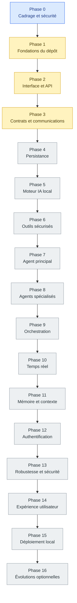

# ASTRON CORE

## Architecture du projet — feuille de route

*Plan de construction progressif • étapes, sous-étapes, validations et livrables*

**Objectif :** construire une plateforme locale d’agents IA coordonnés par un agent principal, avec une interface Angular, une API Node.js/Express et un moteur IA local via Ollama. Le projet est indépendant de l’ancien dossier `ASTRON`.

---

# 1. Principes de réalisation

- [ ] Avancer une étape à la fois : exécuter les commandes, examiner les sorties, puis seulement passer à la suite.
- [ ] Valider chaque couche avant d’ajouter la suivante : interface, API, persistance, IA, outils, orchestration.
- [ ] Privilégier les services locaux et gratuits ; aucune API IA payante ne doit être nécessaire au fonctionnement de base.
- [ ] Appliquer le principe du moindre privilège : un agent ne peut appeler que les outils et actions explicitement autorisés.
- [ ] Garder les opérations sensibles sous confirmation humaine : suppression, écriture de fichiers, commandes système et accès réseau.
- [ ] Ne jamais modifier l’ancien projet `~/Desktop/MESPROJET/ASTRON` ; le nouveau projet reste dans `ASTRON-CORE`.
- [ ] Chaque étape doit inclure des tests reproductibles et une définition claire de « terminé ».
- [ ] Ne valider une étape qu’après examen des preuves techniques.
- [ ] Ne pas passer à l’étape suivante sans validation explicite de l’étape en cours.

---

# 2. Vue d’ensemble des phases

| Phase | Nom | Résultat attendu | Statut |
|---:|---|---|---|
| 0 | Cadrage et sécurité | Périmètre, objectifs, règles d’accès et critères de réussite | Clôturée — validation documentaire ; validations techniques en attente |
| 1 | Fondations du dépôt | Structure, configuration, qualité du code et Git | À vérifier |
| 2 | Interface et API de base | Dashboard Angular relié à Express | Partiellement validée |
| 3 | Contrats et communications | Types partagés, erreurs, événements et suivi des requêtes | En cours |
| 4 | Persistance | Base de données, utilisateurs, conversations et tâches | En attente |
| 5 | Moteur IA local | Ollama, modèle, prompts système et gestion des erreurs | En attente |
| 6 | Outils sécurisés | Calculatrice, informations système en lecture seule, registre d’outils | En attente |
| 7 | Agent principal | Compréhension de la demande, planification et sélection d’outils | En attente |
| 8 | Agents spécialisés | Agents par domaine avec contrats et permissions propres | En attente |
| 9 | Orchestration | Délégation, exécution contrôlée, résultats et reprise sur erreur | En attente |
| 10 | Temps réel | Flux de réponse, événements et état des tâches | En attente |
| 11 | Mémoire et contexte | Historique, résumé de conversation et mémoire contrôlée | En attente |
| 12 | Authentification et permissions | Sessions, rôles, validation et isolation des données | En attente |
| 13 | Robustesse et sécurité | Tests, limites, journalisation, anti-abus et secrets | En attente |
| 14 | Expérience utilisateur | Conversations, tâches, agents, réglages et états de chargement | En attente |
| 15 | Déploiement local | Démarrage reproductible, sauvegardes et documentation | En attente |
| 16 | Évolutions optionnelles | Nouveaux agents, connecteurs, fichiers et automatisations | En attente |

**Légende des statuts**

- `À vérifier` : aucune preuve suffisante pour valider la phase.
- `En cours` : des critères sont validés, d’autres restent à réaliser.
- `Partiellement validée` : une partie des critères est confirmée.
- `En attente` : les travaux ne doivent pas encore commencer.
- `Terminée` : tous les critères de sortie sont testés et validés.

---

# 3. Diagramme visuel de l’architecture et des phases



> Le diagramme représente l’ordre de construction prévu, pas une preuve de réalisation. Les statuts doivent être mis à jour à partir des tests et des validations réelles.

---

# 4. Plan détaillé par étapes

# PHASE 0 — Cadrage et sécurité

**Statut documentaire : CLÔTURÉ — VALIDATION DOCUMENTAIRE**
**Date de référence : 21/10/2026**

La Phase 0 est structurée dans les cinq documents de référence suivants :

- `docs/PHASE-0.1-VISION-OBJECTIFS.md`
- `docs/PHASE-0.2-PERIMETRE-LIMITES.md`
- `docs/PHASE-0.3-PERMISSIONS-CONFIRMATIONS.md`
- `docs/PHASE-0.4-CRITERES-REUSSITE.md`
- `docs/PHASE-0.5-VALIDATION-CADRAGE.md`

## 0.1 Vision et objectifs

- [x] Vision générale et objectifs documentés.
- [x] Architecture cible décrite : interface Angular, API Node.js/Express et moteur IA local via Ollama.
- [x] Rôle de l'agent coordinateur et des agents spécialisés défini dans le cadrage.
- [x] Principe de fonctionnement de base sans service IA payant documenté.

## 0.2 Périmètre et limites

- [x] Périmètre fonctionnel et limites documentés.
- [x] Lecture, calcul et modification distingués dans le cadrage.
- [x] Actions destructrices et commandes arbitraires interdites par défaut dans les exigences.
- [x] Protection des données sensibles et limites d'accès définies comme exigences.

## 0.3 Permissions et confirmations

- [x] Niveaux de risque et règles de permissions documentés.
- [x] Principe de moindre privilège défini.
- [x] Confirmations humaines prévues pour les actions sensibles.
- [x] Confirmation liée à l'action et à ses paramètres exacts dans les exigences.
- [x] Refus, contrôles d'autorisation et traçabilité prévus dans le cadrage.

## 0.4 Critères de réussite

- [x] Critères de réussite et exigences de suivi des tâches documentés.
- [x] Exigences de validation des entrées, de classification des erreurs et de tests reproductibles définies.
- [x] Exigences de journalisation sans secrets documentées.
- [x] Conditions de fonctionnement local sans service payant documentées.

## 0.5 Validation du cadrage

- [x] Les cinq documents de cadrage sont présents dans le dépôt.
- [x] Les exigences de vision, de périmètre, de permissions et de réussite sont documentées.
- [x] La distinction entre validation documentaire et validation technique est explicitée.
- [x] Les ambiguïtés documentaires bloquantes ont été examinées et résolues.
- [x] L'utilisateur a explicitement accepté le cadrage documentaire.
- [x] La décision finale de clôture documentaire est consignée dans les documents de référence.

### Conditions de clôture documentaire de la Phase 0

La clôture documentaire porte sur la cohérence du cadrage, la résolution des ambiguïtés bloquantes et l'acceptation explicite de l'utilisateur. Elle ne prouve pas l'implémentation des exigences de sécurité.

- [x] Vision, périmètre, permissions et critères de réussite documentés.
- [x] Les cinq documents de cadrage sont présents.
- [x] Les ambiguïtés documentaires bloquantes sont résolues.
- [x] L'utilisateur a explicitement prononcé la clôture documentaire de la Phase 0.

### Suivi technique obligatoire dans les phases d'implémentation

- [ ] Contrôles techniques de sécurité implémentés et vérifiés sur preuves.
- [ ] Tests automatisés de sécurité exécutés et résultats examinés.
- [ ] Critères techniques de réussite validés sur preuves.

Ces points restent ouverts jusqu'à la production et à l'examen de preuves techniques. Ils ne constituent pas des validations déjà acquises et ne doivent pas être cochés sur la seule base de la documentation.

**Règle de sécurité :** la lecture des données explicitement autorisées constitue le périmètre initial. La création, la modification, le déplacement et la suppression de fichiers restent désactivés par défaut tant que les mécanismes d'autorisation, de confirmation et de contrôle n'ont pas été implémentés et validés.

---

# PHASE 1 — Fondations du dépôt

## 1.1 Vérifier l’environnement

- [ ] Versions Node.js et npm documentées.
- [ ] Version d’Angular et de TypeScript vérifiée.
- [ ] Version d’Ollama vérifiée.
- [ ] Ports et commandes de démarrage documentés.

## 1.2 Organiser les dossiers

- [ ] `frontend/` : application Angular.
- [ ] `backend/` : API Express et logique serveur.
- [ ] `shared/` : contrats partagés.
- [ ] `docs/` : architecture, décisions et procédures.
- [ ] `scripts/` : scripts de développement et de synchronisation si nécessaires.

## 1.3 Fiabiliser la configuration

- [ ] Variables d’environnement documentées.
- [ ] Fichiers `.env` exclus de Git.
- [ ] Exemple `.env.example` disponible.
- [ ] Scripts `dev`, `build`, `typecheck` et `test` définis et testés.
- [ ] Configuration de développement séparée de celle de production.

## 1.4 Contrôler Git

- [ ] Vérifier que le dépôt Git est celui d’ASTRON-CORE.
- [ ] Ajouter un `.gitignore` adapté.
- [ ] Vérifier les fichiers suivis par Git.
- [ ] Créer des commits après les jalons validés, uniquement avec autorisation.

### Critères de sortie de la phase 1

- [ ] Arborescence stable.
- [ ] Configuration documentée.
- [ ] Scripts principaux fonctionnels.
- [ ] Dépôt indépendant de l’ancien projet.

---

# PHASE 2 — Interface et API de base

## 2.1 API

- [x] Endpoint de santé `/api/health` implémenté.
- [x] Réponses JSON cohérentes et erreurs 404.
- [x] CORS configuré.
- [x] Helmet activé.
- [x] Limite de taille des requêtes JSON.
- [x] Tests backend associés exécutés avec succès.

## 2.2 Dashboard Angular

- [ ] Navigation et panneaux de statut.
- [ ] État réel du backend affiché.
- [ ] États de chargement et d’erreur.
- [ ] Bouton d’actualisation.
- [ ] Affichage accessible du statut du backend.
- [ ] Vérifier que l’état affiché provient d’une vraie requête HTTP.

## 2.3 Validation

- [x] Compilation backend réussie.
- [x] Tests backend réussis.
- [ ] Compiler le frontend.
- [ ] Tester l’API avec `curl`.
- [ ] Vérifier le tableau de bord dans le navigateur.
- [ ] Vérifier la connexion réelle entre le frontend et le backend.

### Critères de sortie de la phase 2

- [ ] Frontend et backend démarrent séparément.
- [x] `/api/health` répond avec un statut HTTP 200 selon les tests déjà exécutés.
- [ ] Le dashboard affiche le statut réel de l’API.
- [ ] Les erreurs réseau sont correctement affichées.

---

# PHASE 3 — Contrats et communications

## 3.1 Définir les contrats

- [x] Format commun des réponses de succès.
- [x] Format commun des erreurs.
- [x] Contrat de santé du backend.
- [x] Identifiant unique de requête via `X-Request-Id`.
- [x] Horodatage dans la réponse de santé.
- [ ] Format commun des requêtes métier.
- [ ] Schémas de validation à l’entrée de l’API.
- [ ] Tests de validation des données incorrectes.

## 3.2 Définir les événements

- [ ] `task.created`.
- [ ] `task.started`.
- [ ] `task.progress`.
- [ ] `task.completed`.
- [ ] `task.failed`.
- [ ] Format commun des événements.
- [ ] Identifiant unique de tâche.
- [ ] Horodatage des événements.
- [ ] État et progression documentés.
- [ ] Règles de transition entre états définies.
- [ ] Gestion des événements dupliqués ou dans le désordre documentée.
- [ ] Aucun couplage obligatoire à Socket.IO avant la définition du contrat.

### Critères de sortie de la phase 3

- [ ] Contrats API documentés.
- [ ] Schémas de validation définis et testés.
- [ ] Contrats d’événements définis dans les contrats partagés.
- [ ] États et progression des tâches documentés.
- [x] Identifiant de requête vérifié par les tests.
- [x] Horodatage de santé présent.
- [x] Tests backend, `typecheck` et `build` réussis sur l’état actuellement validé.
- [ ] Nouvelle validation complète après ajout des éléments manquants.

**Statut actuel : EN COURS.** Les contrats de base et les identifiants de requête sont implémentés, mais les schémas de validation et les contrats d’événements restent à réaliser.

---

# PHASE 4 — Persistance

## 4.1 Choisir le stockage

- [ ] Confirmer MongoDB ou choisir une alternative locale selon les besoins.
- [ ] Définir les données à conserver.
- [ ] Définir la durée de conservation.
- [ ] Définir la stratégie de migration du schéma.
- [ ] Documenter les sauvegardes.

## 4.2 Modèles

- [ ] Utilisateur et session.
- [ ] Conversation et messages.
- [ ] Tâche et état d’exécution.
- [ ] Résultat d’outil.
- [ ] Journaux d’audit.
- [ ] Relations et règles d’accès documentées.

## 4.3 Fiabilité

- [ ] Validation des données.
- [ ] Gestion des connexions et erreurs.
- [ ] Fermeture propre des connexions.
- [ ] Sauvegarde testée.
- [ ] Restauration testée.
- [ ] Tests d’intégration du stockage.

### Critères de sortie de la phase 4

- [ ] Stockage choisi et documenté.
- [ ] Modèles validés.
- [ ] Tests de persistance réussis.
- [ ] Sauvegarde et restauration démontrées.

---

# PHASE 5 — Moteur IA local

## 5.1 Vérifier Ollama

- [ ] Confirmer que le service local répond.
- [ ] Lister les modèles déjà disponibles avant tout téléchargement.
- [ ] Confirmer le modèle retenu.
- [ ] Vérifier les ressources nécessaires au modèle.
- [ ] Éviter tout téléchargement non demandé.

## 5.2 Créer un service IA

- [ ] Centraliser les appels au moteur local.
- [ ] Configurer les délais d’attente.
- [ ] Limiter la taille des entrées et des réponses.
- [ ] Gérer le modèle absent.
- [ ] Gérer l’indisponibilité du service.
- [ ] Gérer les sorties invalides.
- [ ] Définir les paramètres de génération.
- [ ] Documenter les prompts système.

## 5.3 Tests

- [ ] Tester une génération simple.
- [ ] Mesurer la latence.
- [ ] Mesurer les erreurs.
- [ ] Tester un service Ollama indisponible.
- [ ] Tester une réponse invalide ou vide.
- [ ] Ne jamais exposer les secrets ou données privées dans les logs.

### Critères de sortie de la phase 5

- [ ] Génération locale fonctionnelle.
- [ ] Gestion des erreurs vérifiée.
- [ ] Limites et délais configurés.
- [ ] Tests reproductibles documentés.

---

# PHASE 6 — Outils sécurisés

## 6.1 Registre d’outils

- [ ] Nom et description.
- [ ] Schéma d’entrée et de sortie.
- [ ] Permissions nécessaires.
- [ ] Niveau de risque.
- [ ] Validation stricte des paramètres.
- [ ] Identifiant stable pour chaque outil.
- [ ] Règles d’exécution documentées.

## 6.2 Outils de départ

- [ ] Calculatrice sans `eval`.
- [ ] Informations système en lecture seule.
- [ ] Aucun shell arbitraire au départ.
- [ ] Aucun accès réseau non autorisé.
- [ ] Aucun accès aux fichiers non autorisé.

## 6.3 Exécution

- [ ] Délai maximal d’exécution.
- [ ] Gestion des erreurs.
- [ ] Journaliser la demande et le résultat.
- [ ] Vérifier les permissions avant chaque exécution.
- [ ] Confirmation humaine avant toute action sensible.
- [ ] Tests d’entrées invalides.
- [ ] Tests de refus d’accès.

### Critères de sortie de la phase 6

- [ ] Registre d’outils fonctionnel.
- [ ] Permissions vérifiées côté serveur.
- [ ] Paramètres validés.
- [ ] Outils testés individuellement.
- [ ] Aucune commande arbitraire accessible par défaut.

---

# PHASE 7 — Agent principal

## 7.1 Comprendre la demande

- [ ] Recevoir le message et le contexte utile.
- [ ] Détecter si une réponse directe suffit.
- [ ] Détecter si un outil est requis.
- [ ] Identifier les demandes ambiguës.
- [ ] Déterminer si une confirmation humaine est nécessaire.

## 7.2 Planifier

- [ ] Produire un plan structuré et limité.
- [ ] Vérifier le plan avant toute exécution.
- [ ] Fixer un nombre maximal d’étapes.
- [ ] Fixer un nombre maximal d’appels d’outils.
- [ ] Vérifier les permissions de chaque action prévue.
- [ ] Refuser les plans non autorisés.

## 7.3 Répondre

- [ ] Synthétiser les résultats.
- [ ] Distinguer les faits obtenus des incertitudes.
- [ ] Gérer les refus.
- [ ] Gérer les erreurs.
- [ ] Gérer les demandes ambiguës.
- [ ] Éviter d’affirmer qu’une action a réussi sans preuve.

### Critères de sortie de la phase 7

- [ ] Agent principal opérationnel.
- [ ] Choix entre réponse directe et outil testé.
- [ ] Plan limité et contrôlé.
- [ ] Réponse finale cohérente avec les résultats disponibles.

---

# PHASE 8 — Agents spécialisés

## 8.1 Définir un contrat commun

- [ ] Entrée et sortie.
- [ ] Objectifs et limites.
- [ ] Permissions.
- [ ] Temps maximal d’exécution.
- [ ] Format des erreurs.
- [ ] Format des résultats.
- [ ] Périmètre explicite pour chaque agent.

## 8.2 Ajouter les agents progressivement

- [ ] Agent recherche ou knowledge local.
- [ ] Agent calcul et analyse.
- [ ] Agent système en lecture seule.
- [ ] Ajouter d’autres agents seulement après tests.
- [ ] Mesurer la fiabilité de chaque agent.

## 8.3 Vérifier l’isolation

- [ ] Un agent ne peut pas s’octroyer des permissions.
- [ ] Pas d’accès direct aux secrets.
- [ ] Résultats structurés et traçables.
- [ ] Validation des sorties avant utilisation par un autre agent.
- [ ] Limites de contexte et d’exécution définies.

### Critères de sortie de la phase 8

- [ ] Plusieurs agents ont des rôles distincts.
- [ ] Leurs contrats sont documentés.
- [ ] Les permissions sont appliquées.
- [ ] Les résultats sont vérifiables.

---

# PHASE 9 — Orchestration

## 9.1 Délégation

- [ ] L’agent principal choisit un agent spécialisé.
- [ ] Transmettre seulement le contexte nécessaire.
- [ ] Limiter le parallélisme.
- [ ] Limiter la durée.
- [ ] Limiter le nombre de délégations.
- [ ] Définir le suivi des tâches.

## 9.2 Agrégation

- [ ] Vérifier les sorties des agents.
- [ ] Résoudre les échecs partiels.
- [ ] Produire une synthèse finale cohérente.
- [ ] Conserver la provenance des résultats utiles.
- [ ] Éviter les doublons dans la synthèse.

## 9.3 Résilience

- [ ] Annulation d’une tâche.
- [ ] Timeout.
- [ ] Reprise contrôlée.
- [ ] Prévention des boucles.
- [ ] Traçage de chaque étape de l’exécution.
- [ ] Gestion des tâches interrompues.

### Critères de sortie de la phase 9

- [ ] Délégation et retour des résultats testés.
- [ ] Erreurs partielles gérées.
- [ ] Limites d’exécution appliquées.
- [ ] Annulation et traçabilité vérifiées.

---

# PHASE 10 — Temps réel

## 10.1 Choisir le transport

- [ ] Évaluer SSE pour un flux serveur simple.
- [ ] Évaluer Socket.IO si des échanges bidirectionnels sont nécessaires.
- [ ] Décider à partir des besoins réels, pas par défaut.
- [ ] Conserver le contrat d’événements indépendant du transport.

## 10.2 Afficher la progression

- [ ] Événements de tâche.
- [ ] Réponse progressive si le moteur le permet.
- [ ] Reconnexion.
- [ ] État final cohérent.
- [ ] Gestion des tâches interrompues.
- [ ] Gestion des erreurs de transport.

## 10.3 Tester

- [ ] Connexion interrompue.
- [ ] Événement en double.
- [ ] Événement dans le désordre.
- [ ] Échec d’un agent pendant une tâche.
- [ ] Reconnexion après une interruption.
- [ ] Réception de l’état final.

### Critères de sortie de la phase 10

- [ ] Progression affichée en temps réel.
- [ ] État final fiable.
- [ ] Reconnexion testée.
- [ ] Erreurs de transport gérées.

---

# PHASE 11 — Mémoire et contexte

## 11.1 Historique

- [ ] Enregistrer les messages et résultats utiles.
- [ ] Limiter la taille du contexte transmis au modèle.
- [ ] Définir une stratégie de sélection du contexte.
- [ ] Contrôler la durée de conservation.
- [ ] Séparer les conversations.

## 11.2 Résumés

- [ ] Créer un résumé de conversation vérifiable.
- [ ] Éviter de transformer une hypothèse en fait.
- [ ] Conserver les informations utiles à la continuité.
- [ ] Mettre à jour les résumés de manière contrôlée.
- [ ] Gérer les résumés trop volumineux.

## 11.3 Contrôle utilisateur

- [ ] Possibilité d’effacer l’historique selon les règles définies.
- [ ] Ne pas mémoriser les secrets.
- [ ] Séparer mémoire temporaire et mémoire persistante.
- [ ] Documenter les règles de conservation.
- [ ] Tester l’effacement des données.

### Critères de sortie de la phase 11

- [ ] Historique récupérable.
- [ ] Résumés vérifiables.
- [ ] Contrôle utilisateur disponible.
- [ ] Secrets exclus de la mémoire.

---

# PHASE 12 — Authentification et permissions

## 12.1 Identité

- [ ] Décider si le mode multi-utilisateur est retenu.
- [ ] Inscription et connexion si nécessaires.
- [ ] Hachage sûr des mots de passe.
- [ ] Sessions sécurisées.
- [ ] Déconnexion.
- [ ] Expiration et révocation des sessions.

## 12.2 Autorisations

- [ ] Contrôles côté serveur pour chaque route et outil.
- [ ] Isolation des conversations par utilisateur.
- [ ] Protection contre l’accès direct aux identifiants d’autres utilisateurs.
- [ ] Vérification des permissions à chaque action sensible.
- [ ] Refus par défaut si les droits ne sont pas établis.

## 12.3 Vérification

- [ ] Tests des accès autorisés et refusés.
- [ ] Cookies et CORS cohérents en environnement local.
- [ ] Tests de session expirée.
- [ ] Tests d’accès à des ressources appartenant à un autre utilisateur.
- [ ] Vérification des données renvoyées par l’API.

### Critères de sortie de la phase 12

- [ ] Authentification testée si nécessaire.
- [ ] Autorisations appliquées côté serveur.
- [ ] Isolation des données vérifiée.
- [ ] Sessions sécurisées et révocables.

---

# PHASE 13 — Robustesse et sécurité

## 13.1 Tests

- [ ] Tests unitaires des outils et validateurs.
- [ ] Tests d’intégration API et moteur IA.
- [ ] Tests de bout en bout pour une tâche complète.
- [ ] Tests des erreurs réseau.
- [ ] Tests des limites et délais.
- [ ] Tests des permissions.
- [ ] Tests de non-régression.

## 13.2 Protection

- [ ] Limites de requêtes, délais et taille.
- [ ] Protection contre les injections de prompt.
- [ ] Traiter les instructions provenant des outils comme des données non fiables.
- [ ] Aucun secret ou jeton dans le dépôt.
- [ ] Aucun accès réseau non autorisé.
- [ ] Aucun accès arbitraire aux fichiers.
- [ ] Confirmation humaine pour les actions sensibles.

## 13.3 Observabilité

- [ ] Logs structurés et niveaux adaptés.
- [ ] Identifiants de corrélation.
- [ ] Messages d’erreur utiles sans données sensibles.
- [ ] Durées d’exécution mesurables.
- [ ] Suivi des échecs et reprises.
- [ ] Procédure de diagnostic documentée.

### Critères de sortie de la phase 13

- [ ] Tests de sécurité exécutés.
- [ ] Erreurs et incidents traçables.
- [ ] Secrets protégés.
- [ ] Limites appliquées.
- [ ] Aucun défaut bloquant connu.

---

# PHASE 14 — Expérience utilisateur

## 14.1 Conversations

- [ ] Composer et envoyer une demande.
- [ ] Afficher la réponse.
- [ ] Afficher la progression.
- [ ] Afficher les erreurs.
- [ ] Annuler une tâche en cours.
- [ ] Gérer les états vides.
- [ ] Permettre de reprendre une conversation si prévu.

## 14.2 Vue des agents

- [ ] Montrer l’agent principal et les agents mobilisés.
- [ ] Afficher les permissions et outils utilisés.
- [ ] Expliquer les étapes exécutées sans exposer les secrets ni le raisonnement interne privé.
- [ ] Afficher les résultats d’outils utiles.
- [ ] Distinguer une action terminée d’une action échouée.

## 14.3 Finitions

- [ ] Responsive.
- [ ] Navigation clavier.
- [ ] États vides.
- [ ] Accessibilité.
- [ ] Contrastes.
- [ ] États de chargement.
- [ ] Paramètres locaux.
- [ ] Choix du modèle.
- [ ] Messages d’erreur compréhensibles.

### Critères de sortie de la phase 14

- [ ] Parcours principal utilisable.
- [ ] États de chargement et d’erreur vérifiés.
- [ ] Navigation accessible.
- [ ] Affichage responsive validé.

---

# PHASE 15 — Déploiement local

## 15.1 Démarrage reproductible

- [ ] Instructions exactes pour lancer le backend.
- [ ] Instructions exactes pour lancer le frontend.
- [ ] Instructions exactes pour lancer Ollama.
- [ ] Vérifier ports, dépendances et variables.
- [ ] Documenter les prérequis.
- [ ] Tester le démarrage depuis un environnement propre.

## 15.2 Sauvegarde

- [ ] Procédure de sauvegarde des données.
- [ ] Procédure de restauration testée.
- [ ] Documenter les fichiers et données à protéger.
- [ ] Vérifier les permissions sur les sauvegardes.

## 15.3 Documentation

- [ ] README d’installation.
- [ ] Guide de dépannage.
- [ ] Architecture à jour.
- [ ] Décisions techniques documentées.
- [ ] Commandes de test documentées.
- [ ] Procédure de mise à jour documentée.

### Critères de sortie de la phase 15

- [ ] Installation reproductible.
- [ ] Démarrage documenté.
- [ ] Sauvegarde et restauration testées.
- [ ] Documentation complète.

---

# PHASE 16 — Évolutions optionnelles

## 16.1 Extensions

- [ ] Recherche documentaire locale.
- [ ] Traitement de fichiers avec validation.
- [ ] Connecteurs externes explicitement activés.
- [ ] Nouveaux agents spécialisés.
- [ ] Nouvelles capacités uniquement après validation de leur sécurité.

## 16.2 Automatisation

- [ ] Tâches planifiées seulement avec permissions claires.
- [ ] Historique des tâches.
- [ ] Arrêt d’urgence.
- [ ] Limites de fréquence.
- [ ] Confirmation pour les opérations sensibles.

## 16.3 Évaluation

- [ ] Mesurer la fiabilité.
- [ ] Mesurer la latence.
- [ ] Mesurer les ressources locales utilisées.
- [ ] Identifier les échecs fréquents.
- [ ] Ajouter des capacités seulement si elles apportent une valeur démontrée.

### Critères de sortie de la phase 16

- [ ] Chaque extension a un périmètre documenté.
- [ ] Les permissions sont définies.
- [ ] Les tests sont reproductibles.
- [ ] Les bénéfices sont mesurés.

---

# 5. Jalons de validation

| Jalon | Nom | Critère de validation | Statut |
|---|---|---|---|
| A | Base locale | Frontend et backend démarrent séparément ; `/api/health` répond ; le dashboard affiche l’état réel | À valider |
| B | Premier outil | Un outil sûr est appelé via une route contrôlée et ses entrées/sorties sont validées | En attente |
| C | Première boucle IA | Une demande simple est traitée par Ollama avec une réponse exploitable | En attente |
| D | Agent coordinateur | L’agent principal décide entre réponse directe et outil autorisé | En attente |
| E | Équipe d’agents | Un agent spécialisé est délégué, supervisé puis résumé | En attente |
| F | Flux de tâche | Progression et état final sont affichés, même après une erreur récupérable | En attente |
| G | Version locale fiable | Tests, documentation, permissions et sauvegarde sont vérifiés | En attente |

---

# 6. État réel du projet

## 6.1 Éléments techniques confirmés

| Élément | Résultat constaté |
|---|---|
| Endpoint `/api/health` | Implémenté |
| Contrats API communs | Présents |
| Identifiant `X-Request-Id` | Implémenté |
| Unicité de l’identifiant de requête | Testée |
| Horodatage de santé | Implémenté |
| Tests backend | 7 réussis, 0 échec |
| TypeScript backend | `typecheck` réussi |
| Compilation backend | `build` réussi |
| Validation générique des entrées API | À réaliser |
| Contrats d’événements de tâches | À réaliser |
| État et progression des tâches documentés | À réaliser |
| Intégration réelle du dashboard Angular | À vérifier |
| Persistance | Pas encore commencée |

## 6.2 Commandes de validation backend

Depuis la racine `ASTRON-CORE`, les commandes déjà validées sont :

```bash
npm --prefix backend test
npm --prefix backend run typecheck
npm --prefix backend run build
```

Résultats confirmés lors de la dernière validation :

- Tests backend : 7 réussis, 0 échec.
- TypeScript : réussi.
- Build backend : réussi.

Ces résultats correspondent à l’état du code au moment de leur exécution. Il faut relancer les commandes après toute modification du backend.

## 6.3 État initial du projet

- [x] Dépôt indépendant `ASTRON-CORE` créé.
- [x] Backend Express avec `/api/health` testé en HTTP 200.
- [ ] Frontend Angular compilé et démarré en mode développement : validation à confirmer.
- [ ] Dashboard initial présent et vérifié dans le navigateur.
- [ ] Vérifier que le statut du backend affiché correspond à une vraie requête HTTP.
- [ ] Valider l’intégration frontend/backend.
- [ ] Terminer la phase 3 avant de commencer la phase 4.

---

# 7. Journal de progression

Utiliser cette section pour noter les dates, résultats des tests, problèmes rencontrés et décisions prises.

| Date | Phase / étape | Résultat / preuve | Prochaine action |
|---|---|---|---|
| 21/10/2026 | Phase 3 — Contrats et communications | 7 tests backend réussis ; `typecheck` et `build` réussis ; `X-Request-Id` et horodatage implémentés | Définir les schémas de validation et les contrats d’événements |
| | | | |
| | | | |
| | | | |
| | | | |
| | | | |
| | | | |
| | | | |
| | | | |
| | | | |

## Modèle pour une nouvelle entrée

```text
Date :
Phase / étape :
Commande exécutée :
Résultat observé :
Preuve ou fichier concerné :
Problème éventuel :
Décision :
Prochaine action :
```

---

# 8. Prochaine action recommandée

**Phase 3 — Contrats et communications**

1. Définir les contrats d’événements de tâches dans `shared/contracts/`, sans ajouter Socket.IO.
2. Documenter les états possibles et les règles de progression.
3. Définir des schémas réutilisables de validation des entrées API.
4. Ajouter des tests reproductibles.
5. Relancer les tests, le `typecheck` et le `build`.
6. Mettre à jour cette feuille de route à partir des résultats réels.
7. Passer à la phase 4 uniquement après validation complète de la phase 3.

---

# 9. Règles de suivi

- Une case cochée doit correspondre à un résultat réellement obtenu.
- Ne pas confondre « code écrit » et « fonctionnalité validée ».
- Noter les commandes et résultats importants dans le journal.
- Ne pas lancer plusieurs changements indépendants à la fois.
- Ne pas ajouter Socket.IO avant d’avoir défini les contrats d’événements.
- Ne pas commencer la persistance tant que les contrats de la phase 3 ne sont pas validés.
- Ne pas modifier l’ancien dossier `ASTRON`.
- Ne jamais effectuer de commit ou de push Git sans autorisation explicite.

**Fin du document — ASTRON CORE**